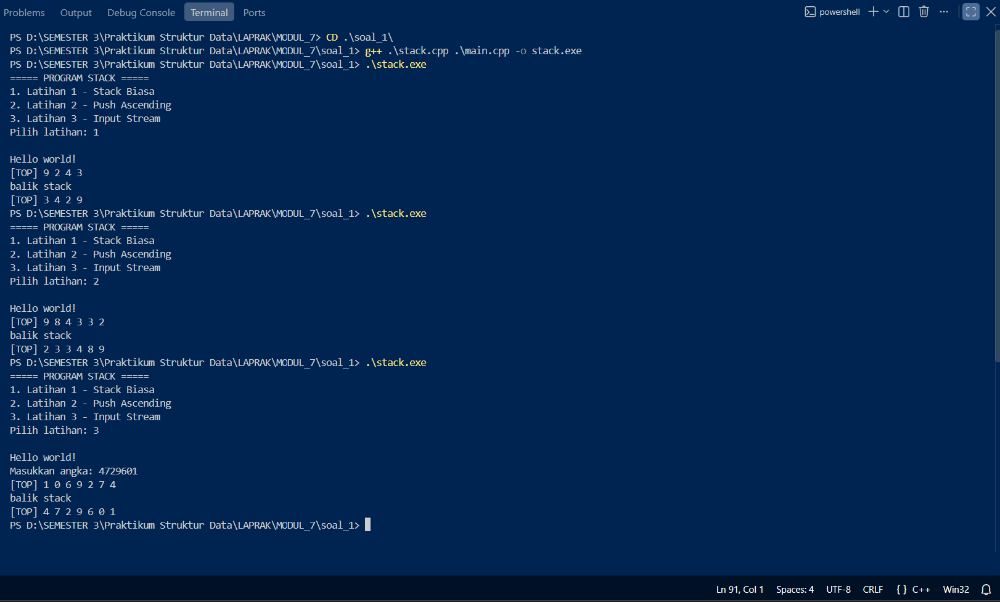

# <h1 align="center">Laporan Praktikum Modul 7 - Stack</h1>
<p align="center">AHMAD LUTHFI HABIBIE - 109082500190</p>

## Dasar Teori

### A. Konsep Stack<br/>
*Stack* (tumpukan) adalah struktur data yang prinsip kerjanya seperti tumpukan benda: elemen yang bisa diambil lebih dulu adalah elemen yang paling atas, yaitu elemen yang terakhir dimasukkan. Prinsip ini disebut **LIFO** (*Last In First Out*) [1]. Komponen *stack* pada dasarnya sama dengan *singly linked list*, hanya saja aksesnya dibatasi di satu ujung saja yang disebut `Top` [1]. Pembatasan akses ini juga dikenal pada literatur struktur data lain, yaitu *stack* sebagai bentuk khusus dari list yang penyisipan dan penghapusannya hanya dilakukan di satu sisi [3][4]. Karena tidak ada penelusuran, operasi dasar *stack* (*push* dan *pop*) hanya menyentuh elemen teratas sehingga berjalan dengan kompleksitas waktu konstan O(1) [2].

#### 1. Operasi Push dan Pop
Ada dua operasi utama pada *stack*, yaitu *Push* (penyisipan) dan *Pop* (pengambilan) [1]. Pada representasi *pointer*, *Push* sama dengan *insert first* pada list: elemen baru dialokasikan, `next`-nya diarahkan ke `S.Top`, lalu `S.Top` dipindahkan ke elemen baru. *Pop* sama dengan *delete first*: alamat `S.Top` disimpan ke `P`, `S.Top` digeser ke `(S.Top)->next`, kemudian `P` dikembalikan [1]. Pada representasi tabel (*array*), *Push* dilakukan dengan menaikkan indeks `Top` (`Top = Top+1`) lalu mengisi data pada indeks tersebut, sedangkan *Pop* mengambil `S.Info[Top]` lalu menurunkan indeks (`Top = Top-1`) tanpa menghapus isi lama dari *array* [1]. Mengambil dari *stack* kosong disebut *underflow*, dan memasukkan ke *stack* yang sudah penuh pada representasi tabel disebut *overflow*, sehingga keduanya perlu dicek sebelum operasi dijalankan [4].

#### 2. Primitif pada Stack
Primitif *stack* pada dasarnya sama dengan primitif list lain, tetapi jumlahnya lebih sedikit karena hanya elemen teratas yang diproses. Pada representasi *pointer*, primitifnya adalah `createStack()`, `isEmpty()`, `alokasi()`, `dealokasi()`, fungsi pencarian, dan primitif lainnya. Pada representasi tabel, `alokasi()` dan `dealokasi()` tidak diperlukan karena tidak ada manajemen memori dinamis [1]. Seperti model list yang lain, primitif disimpan dalam file `*.h` untuk deklarasi dan file `*.cpp` untuk realisasinya [1].

### B. Stack Representasi Tabel (Array)<br/>
Pada representasi tabel, *stack* dibuat dari *array* berindeks dengan jumlah tumpukan yang terbatas (`Imax`). Kondisi *stack* kosong ditandai dengan `Top = 0`, dan *stack* penuh ketika `Top` mencapai `Imax` [1]. Pada ADT contoh di modul, `struct Stack` terdiri dari `info[10]` untuk menyimpan elemen dan `Top` bertipe `int` untuk mencatat posisi puncak, lalu prototipe `isEmpty`, `createStack`, `push`, `pop`, dan `viewStack` dideklarasikan di file `stack.h` [1]. Pola yang sama dipakai pada modul praktikum lain: `Push` memeriksa dulu apakah tumpukan penuh, kalau belum maka indeks atas ditambah satu lalu data disimpan [4].

#### 1. Kapasitas Terbatas (Bounded Stack)
Karena ukurannya tetap, *stack* berbasis *array* termasuk jenis *bounded stack*, yaitu *stack* dengan kapasitas terbatas yang dirancang untuk mengendalikan penggunaan memori [2]. Keuntungannya adalah memori yang terpakai bisa diprediksi dan tidak perlu `new`/`delete`. Kekurangannya adalah data yang melebihi kapasitas tidak bisa disimpan, sehingga pengecekan penuh pada `push` menjadi wajib [2][4].

### C. Penerapan dan Perbandingan<br/>
Sifat LIFO membuat *stack* cocok untuk kasus yang menuntut aksi terakhir diproses lebih dulu. Contoh yang banyak dikaji adalah fitur *undo* pada aplikasi, sebab aksi terakhir pengguna adalah aksi pertama yang harus dibatalkan [2]. Contoh lain yang sejalan dengan latihan modul ini adalah membalik urutan data: karena elemen keluar dengan urutan terbalik dari saat masuk, *stack* alami untuk operasi pembalikan [4]. Dibandingkan representasi *pointer*, representasi tabel lebih sederhana karena tidak butuh manajemen memori, tetapi kapasitasnya tetap; sebaliknya representasi *pointer* bisa bertambah sesuai kebutuhan, tetapi memerlukan `alokasi` dan `dealokasi` yang rapi [1][3].

## Guided 

### 1. stack.h

```C++
//stack.h (GUIDED)
/* file : stack.h
   contoh ADT stack dengan representasi tabel */
#ifndef STACK_H_INCLUDED
#define STACK_H_INCLUDED

#include <iostream>
using namespace std;

struct infotype {
    char nim[20];
    char nama[20];
};
struct Stack {
    infotype info[10];
    int Top;
};

/* prototype */
/******** pengecekan apakah Stack kosong *********/
int isEmpty(Stack S);
/* mengembalikan nilai 0 jika stack kosong */

/******** pembuatan Stack ********/
void createStack(Stack &S);
/* I.S. sembarang
   F.S. terbentuk stack dengan Top=0 */

/******** penambahan elemen pada Stack ********/
void push(Stack &S, infotype X);
/* I.S. Stack mungkin kosong
   F.S. menambahkan elemen pada stack dengan nilai X, TOP=TOP+1 */

/******** penghapusan elemen pada Stack ********/
void pop(Stack &S, infotype &X);
/* I.S. stack tidak kosong
   F.S. nilai info pada indeks TOP disimpan pada X, kemudian TOP=TOP-1 */

/******** proses semua elemen Stack *********/
void viewStack(Stack S);
/* I.S. stack mungkin kosong
   F.S. jika stack tidak kosong menampilkan semua info yang ada pada stack
*/
#endif // STACK_H_INCLUDED
```
File `stack.h` berisi spesifikasi tipe data dan prototipe primitif untuk *stack* representasi tabel [1]. `struct infotype` menyimpan data mahasiswa berupa `nim` dan `nama` (masing-masing *array* `char` berukuran 20), sedangkan `struct Stack` berisi `info[10]` sebagai tempat penyimpanan elemen dan `Top` sebagai penunjuk posisi puncak. Dengan `info[10]`, kapasitas maksimum *stack* adalah 10 elemen. Prototipe yang dideklarasikan ada lima: `isEmpty` untuk mengecek kosong, `createStack` untuk membentuk *stack* kosong, `push` untuk menambah elemen, `pop` untuk mengambil elemen teratas, dan `viewStack` untuk menampilkan seluruh isi. Komentar `I.S.` (*initial state*) dan `F.S.` (*final state*) di bawah tiap prototipe menjelaskan kondisi sebelum dan sesudah prosedur dijalankan. Perlu diperhatikan bahwa `isEmpty` pada modul ini mengembalikan nilai `0` jika *stack* kosong (kebalikan dari kebiasaan umum), sehingga seluruh pemanggilannya harus mengikuti aturan tersebut. Baris `#ifndef`, `#define`, dan `#endif` berfungsi sebagai *header guard* supaya file tidak ter-*include* lebih dari sekali.

### 2. stack.cpp

```C++
//stack.cpp (GUIDED)
#include "stack.h"

int isEmpty(Stack S) {
    /* Top = 0 berarti kosong, sesuai komentar di stack.h dikembalikan 0 */
    if (S.Top == 0) {
        return 0;
    } else {
        return 1;
    }
}

void createStack(Stack &S) {
    S.Top = 0;
}

void push(Stack &S, infotype X) {
    if (S.Top < 10) {
        S.Top = S.Top + 1;
        S.info[S.Top - 1] = X;   /* Top 1..10 dipetakan ke indeks array 0..9 */
    } else {
        cout << "Stack penuh, data tidak bisa ditambahkan" << endl;
    }
}

void pop(Stack &S, infotype &X) {
    if (isEmpty(S) != 0) {
        X = S.info[S.Top - 1];
        S.Top = S.Top - 1;
    } else {
        cout << "Stack kosong, tidak ada data yang bisa diambil" << endl;
    }
}

void viewStack(Stack S) {
    if (isEmpty(S) == 0) {
        cout << "Stack kosong" << endl;
    } else {
        cout << "Isi stack (dari TOP):" << endl;
        for (int i = S.Top; i >= 1; i--) {
            cout << i << ". " << S.info[i - 1].nim << " - "
                 << S.info[i - 1].nama << endl;
        }
    }
}
```
File `stack.cpp` berisi realisasi semua primitif yang dideklarasikan di header. `isEmpty` mengembalikan `0` bila `Top == 0` dan `1` bila sebaliknya, sesuai komentar pada `stack.h`. `createStack` cukup mengisi `Top` dengan `0` sehingga *stack* berada pada kondisi kosong [1]. Pada `push`, program mengecek dulu apakah `Top < 10`. Jika masih ada tempat, `Top` dinaikkan satu (`Top = Top + 1`) lalu data `X` disimpan di `info[Top - 1]`. Tanda `- 1` dipakai karena `Top` bernilai 1 sampai 10 sedangkan indeks *array* C++ dimulai dari 0 sampai 9, sehingga `Top` diterjemahkan ke indeks *array* dengan dikurangi satu. Kalau `Top` sudah 10, program mencetak pesan *stack* penuh dan data tidak disimpan, ini adalah pencegahan *overflow* [4].

Prosedur `pop` bekerja kebalikannya. Setelah memastikan *stack* tidak kosong lewat `isEmpty(S) != 0`, nilai pada `info[Top - 1]` disalin ke parameter `X` (yang dikirim secara referensi `&X` sehingga nilainya terbawa keluar), lalu `Top` diturunkan satu. Sesuai penjelasan modul, isi *array* pada posisi lama tidak dihapus, hanya `Top` yang bergeser, dan data lama akan tertimpa pada `push` berikutnya [1]. Jika *stack* kosong, dicetak pesan bahwa tidak ada data yang bisa diambil (pencegahan *underflow*). `viewStack` menampilkan isi dari `Top` turun sampai 1, sehingga data yang terakhir masuk tampil paling atas, sesuai urutan LIFO. Karena hanya mengubah indeks, kedua operasi `push` dan `pop` tidak memerlukan penelusuran dan berjalan dalam O(1) [2].

### 3. main.cpp

```C++
//main.cpp (GUIDED)
#include <iostream>
#include <cstring>
#include "stack.h"
using namespace std;

int main() {
    Stack S;
    infotype data, hasil;

    createStack(S);
    cout << "Stack baru dibuat, Top = " << S.Top << endl;
    viewStack(S);

    cout << endl << "--- Push 3 data ---" << endl;
    strcpy(data.nim, "103112400001");
    strcpy(data.nama, "Andi");
    push(S, data);

    strcpy(data.nim, "103112400002");
    strcpy(data.nama, "Budi");
    push(S, data);

    strcpy(data.nim, "103112400003");
    strcpy(data.nama, "Citra");
    push(S, data);
    viewStack(S);

    cout << endl << "--- Pop 1 data ---" << endl;
    pop(S, hasil);
    cout << "Data yang diambil: " << hasil.nim << " - " << hasil.nama << endl;
    viewStack(S);

    cout << endl << "--- Pop sampai kosong ---" << endl;
    pop(S, hasil);
    pop(S, hasil);
    pop(S, hasil);
    viewStack(S);

    return 0;
}
```
File `main.cpp` berperan sebagai *driver* untuk mencoba semua primitif. Program membuat *stack* kosong dengan `createStack` (`Top = 0`), lalu `viewStack` menampilkan pesan "Stack kosong". Karena `nim` dan `nama` bertipe *array* `char`, pengisiannya memakai `strcpy` dari `<cstring>`. Tiga data dimasukkan berurutan: Andi, Budi, lalu Citra, sehingga Citra berada di puncak. Hasil `viewStack` setelah *push* menampilkan urutan Citra (posisi 3), Budi (posisi 2), Andi (posisi 1), yang membuktikan data terakhir masuk berada paling atas.

Pada tahap *pop*, satu kali pemanggilan `pop(S, hasil)` mengambil Citra, sesuai prinsip LIFO, dan `Top` turun menjadi 2. Setelah itu `pop` dipanggil tiga kali lagi, padahal isi tinggal dua. Dua panggilan pertama mengambil Budi dan Andi, sedangkan panggilan ketiga terjadi pada *stack* kosong sehingga muncul pesan "Stack kosong, tidak ada data yang bisa diambil" dan tidak terjadi kesalahan akses memori. Output yang dihasilkan:

```
Stack baru dibuat, Top = 0
Stack kosong

--- Push 3 data ---
Isi stack (dari TOP):
3. 103112400003 - Citra
2. 103112400002 - Budi
1. 103112400001 - Andi

--- Pop 1 data ---
Data yang diambil: 103112400003 - Citra
Isi stack (dari TOP):
2. 103112400002 - Budi
1. 103112400001 - Andi

--- Pop sampai kosong ---
Stack kosong, tidak ada data yang bisa diambil
Stack kosong
```

## Unguided 

### 1. ADT Stack menggunakan Array pada "stack.h", implementasi pada "stack.cpp", dan percobaan pada "main.cpp" (Latihan 1: stack biasa dan balikStack, Latihan 2: pushAscending, Latihan 3: getInputStream)

**stack.h**
```C++
//stack.h (UNGUIDED)
#ifndef STACK_H
#define STACK_H

typedef int infotype;

struct Stack {
    infotype info[20];
    int top;
};

// Prototype fungsi
void createStack(Stack &S);

void push(Stack &S, infotype X);

infotype pop(Stack &S);

void printInfo(Stack S);

void balikStack(Stack &S);

// Latihan 2
void pushAscending(Stack &S, infotype X);

// Latihan 3
void getInputStream(Stack &S);

#endif
```

**stack.cpp**
```C++
//stack.cpp (UNGUIDED)
#include <iostream>
#include "stack.h"

using namespace std;

// Membuat Stack kosong
void createStack(Stack &S) {
    S.top = 0;
}

// Mengecek dan menambahkan data ke Stack
void push(Stack &S, infotype X) {
    if (S.top == 20) {
        cout << "Stack penuh!" << endl;
    } else {
        S.top++;
        S.info[S.top] = X;
    }
}

// Mengambil data paling atas dari Stack
infotype pop(Stack &S) {
    infotype X;

    if (S.top == 0) {
        cout << "Stack kosong!" << endl;
        return 0;
    } else {
        X = S.info[S.top];
        S.top--;
        return X;
    }
}

// Menampilkan seluruh isi Stack
void printInfo(Stack S) {
    if (S.top == 0) {
        cout << "Stack kosong!" << endl;
    } else {
        cout << "[TOP] ";

        for (int i = S.top; i >= 1; i--) {
            cout << S.info[i] << " ";
        }

        cout << endl;
    }
}

// Membalik urutan Stack
void balikStack(Stack &S) {
    int temp;
    int i = 1;
    int j = S.top;

    while (i < j) {
        temp = S.info[i];
        S.info[i] = S.info[j];
        S.info[j] = temp;

        i++;
        j--;
    }
}

// Memasukkan data secara ascending
void pushAscending(Stack &S, infotype X) {
    if (S.top == 20) {
        cout << "Stack penuh!" << endl;
    } else {
        int i = S.top;

        while (i >= 1 && S.info[i] > X) {
            S.info[i + 1] = S.info[i];
            i--;
        }

        S.info[i + 1] = X;
        S.top++;
    }
}

// Membaca input angka sampai pengguna menekan Enter
void getInputStream(Stack &S) {
    char input;

    cout << "Masukkan angka: ";

    while (cin.get(input) && input != '\n') {
        if (input >= '0' && input <= '9') {
            if (S.top < 20) {
                push(S, input - '0');
            } else {
                cout << "\nStack penuh! Input berikutnya diabaikan.";
                break;
            }
        }
    }
}
```

**main.cpp**
```C++
//main.cpp (UNGUIDED)
#include <iostream>
#include <limits>
#include "stack.h"

using namespace std;

int main() {
    Stack S;
    int pilihan;

    cout << "===== PROGRAM STACK =====" << endl;
    cout << "1. Latihan 1 - Stack Biasa" << endl;
    cout << "2. Latihan 2 - Push Ascending" << endl;
    cout << "3. Latihan 3 - Input Stream" << endl;
    cout << "Pilih latihan: ";
    cin >> pilihan;

    createStack(S);

    switch (pilihan) {

        case 1:
            cout << "\nHello world!" << endl;

            push(S, 3);
            push(S, 4);
            push(S, 8);

            pop(S);

            push(S, 2);
            push(S, 3);

            pop(S);

            push(S, 9);

            printInfo(S);

            cout << "balik stack" << endl;

            balikStack(S);

            printInfo(S);
            break;

        case 2:
            cout << "\nHello world!" << endl;

            pushAscending(S, 3);
            pushAscending(S, 4);
            pushAscending(S, 8);
            pushAscending(S, 2);
            pushAscending(S, 3);
            pushAscending(S, 9);

            printInfo(S);

            cout << "balik stack" << endl;

            balikStack(S);

            printInfo(S);
            break;

        case 3:
            cout << "\nHello world!" << endl;

            cin.ignore(
                numeric_limits<streamsize>::max(), '\n'
            );

            getInputStream(S);

            printInfo(S);

            cout << "balik stack" << endl;

            balikStack(S);

            printInfo(S);
            break;

        default:
            cout << "Pilihan tidak tersedia!" << endl;
    }

    return 0;
}
```
### Output Unguided 1 :

##### Output 1


Program ini mengerjakan tiga soal latihan modul 7 sekaligus dengan satu ADT *Stack* berbasis *array* yang menyimpan data bertipe `int`. Pada `stack.h`, `infotype` didefinisikan sebagai `int` dan `struct Stack` berisi `info[20]` untuk menyimpan elemen serta `top` sebagai penunjuk puncak, sesuai spesifikasi soal. Prototipe yang dideklarasikan adalah lima primitif dari Latihan 1 (`createStack`, `push`, `pop`, `printInfo`, `balikStack`) ditambah `pushAscending` untuk Latihan 2 dan `getInputStream` untuk Latihan 3. Berbeda dengan versi guided, `pop` di sini berupa fungsi yang mengembalikan nilai `infotype`, sehingga nilai yang diambil bisa ditangkap atau diabaikan oleh pemanggilnya.

Di `stack.cpp`, `createStack` mengisi `top` dengan `0` sebagai tanda *stack* kosong. `push` mengecek dulu apakah `top == 20` (penuh); kalau belum, `top` dinaikkan lalu data disimpan di `info[top]`, jadi elemen pertama berada di indeks 1. `pop` mengecek kosong, lalu mengambil `info[top]`, menurunkan `top`, dan mengembalikan nilainya [1]. `printInfo` mencetak tulisan `[TOP]` lalu menampilkan isi dari `top` turun ke 1, sehingga elemen yang terakhir masuk muncul paling kiri. `balikStack` membalik isi *stack* dengan teknik dua penunjuk: `i` mulai dari dasar (indeks 1) dan `j` dari puncak (`top`), lalu `info[i]` ditukar dengan `info[j]` sambil `i` naik dan `j` turun sampai keduanya bertemu. Karena hanya pertukaran isi *array*, nilai `top` tidak berubah.

Untuk Latihan 2, `pushAscending` memasukkan data sambil menjaga isi *stack* tetap terurut dari dasar ke puncak secara menaik, sehingga puncak selalu berisi nilai terbesar. Caranya mirip penyisipan pada *insertion sort*: mulai dari `i = top`, selama `info[i] > X` elemen digeser satu ke atas (`info[i+1] = info[i]`), lalu `X` ditaruh di `info[i+1]` dan `top` dinaikkan. Karena perbandingannya memakai `>` (bukan `>=`), nilai yang sama tidak digeser sehingga data kembar tetap berurutan sesuai masuknya. Untuk Latihan 3, `getInputStream` membaca satu karakter demi satu karakter dengan `cin.get(input)` sampai pengguna menekan Enter (`'\n'`). Setiap karakter yang berupa angka diubah menjadi nilai bilangan dengan `input - '0'` lalu di-*push*; karakter selain angka diabaikan. Jika *stack* sudah penuh, pembacaan dihentikan dan muncul pesan bahwa input berikutnya diabaikan.

Pada `main.cpp`, ketiga latihan digabung dalam satu menu dengan `switch`. Setelah memilih menu lewat `cin >> pilihan`, ada sisa karakter Enter di *buffer* masukan; pada Latihan 3 sisa ini dibuang lebih dulu dengan `cin.ignore(numeric_limits<streamsize>::max(), '\n')` agar `cin.get` tidak langsung berhenti membaca. Pada Latihan 1, urutan operasinya adalah *push* 3, 4, 8, lalu `pop` (membuang 8), *push* 2 dan 3, `pop` lagi (membuang 3), dan *push* 9, sehingga isi akhir dari dasar ke puncak adalah 3, 4, 2, 9. Pada Latihan 2, enam angka (3, 4, 8, 2, 3, 9) dimasukkan dengan `pushAscending` sehingga isinya terurut 2, 3, 3, 4, 8, 9 dari dasar ke puncak. Pada Latihan 3, input `4729601` menghasilkan *stack* dengan angka 4 di dasar dan 1 di puncak.

Pada screenshot, program dikompilasi di terminal VS Code (PowerShell) dari folder `soal_1` dengan perintah `g++ .\stack.cpp .\main.cpp -o stack.exe`, lalu dijalankan tiga kali dengan `.\stack.exe` untuk mencoba ketiga menu secara berurutan. Kompilasi berjalan tanpa pesan *error*. Pada eksekusi pertama dipilih menu `1`, pada eksekusi kedua menu `2`, dan pada eksekusi ketiga menu `3` dengan input `4729601`. Hasil keluarannya adalah sebagai berikut.

Latihan 1 (pilih menu `1`):
```
Hello world!
[TOP] 9 2 4 3 
balik stack
[TOP] 3 4 2 9 
```

Latihan 2 (pilih menu `2`):
```
Hello world!
[TOP] 9 8 4 3 3 2 
balik stack
[TOP] 2 3 3 4 8 9 
```

Latihan 3 (pilih menu `3`, lalu ketik `4729601`):
```
Hello world!
Masukkan angka: 4729601
[TOP] 1 0 6 9 2 7 4 
balik stack
[TOP] 4 7 2 9 6 0 1 
```

Ketiga hasil sama dengan contoh keluaran pada modul (Gambar 7-11, 7-13, dan 7-15) [1]. Pada Latihan 1, `[TOP] 9 2 4 3` menunjukkan 9 sebagai elemen terakhir yang masuk, dan setelah `balikStack` urutannya berbalik menjadi `3 4 2 9`. Pada Latihan 2, puncak berisi 9 (terbesar) dan turun menjadi 2 di dasar, lalu setelah dibalik urutannya menjadi menaik dari puncak. Pada Latihan 3, digit yang diketik paling akhir (1) muncul paling depan, dan setelah dibalik urutannya sama dengan urutan ketikan. Bagian menu pilihan latihan dan tulisan `Masukkan angka:` merupakan tambahan dari program ini dan tidak ada pada contoh gambar modul.

## Kesimpulan
Dari praktikum Modul 7 dapat disimpulkan bahwa *stack* adalah struktur data berprinsip LIFO yang hanya mengizinkan akses pada elemen teratas (`Top`), dengan dua operasi utama yaitu *push* untuk menyisipkan dan *pop* untuk mengambil elemen. Pada representasi tabel, *stack* dibangun dari *array* berkapasitas tetap dengan `Top` sebagai penunjuk puncak, sehingga operasi *push* dan *pop* cukup menggeser indeks tanpa manajemen memori dan berjalan dalam waktu konstan, tetapi harus disertai pengecekan penuh dan kosong agar tidak terjadi *overflow* maupun *underflow*. Pada bagian guided, ADT *stack* untuk data mahasiswa (`nim` dan `nama`) berhasil dibuat lengkap dengan `createStack`, `isEmpty`, `push`, `pop`, dan `viewStack`, dan percobaannya memperlihatkan bahwa data yang terakhir dimasukkan (Citra) adalah yang pertama diambil. Pada bagian unguided, ADT *stack* bertipe `int` berkapasitas 20 berhasil dilengkapi dengan `balikStack` untuk membalik isi *stack*, `pushAscending` untuk memasukkan data secara terurut sehingga puncak selalu berisi nilai terbesar, dan `getInputStream` untuk membaca input digit hingga Enter ditekan, dengan hasil yang sama persis seperti contoh keluaran pada modul.

## Referensi
[1] Laboratorium Informatika, Fakultas Informatika, Telkom University. (t.t.). "Modul 7: Stack", Modul Praktikum Struktur Data. Bandung: Telkom University.
<br>[2] Ramadhan, R. A., & Ikasari, I. H. (2026). "Penerapan Struktur Data Stack untuk Implementasi Fitur Undo pada Aplikasi Sederhana: Literature Review". Journal of Computer Science and Information Technology (JCSIT), 3(3), 163–170. Universitas Pamulang. e-ISSN 3031-8467. Diakses melalui https://journal.ppmi.web.id/index.php/jcsit/article/download/3955/2617/28627.
<br>[3] Shaffer, C. A. "Data Structures and Algorithm Analysis" (Bab 4: Lists, Stacks, and Queues). Virginia Tech. Diakses melalui https://learn.saylor.org/pluginfile.php/591887/mod_resource/content/1/Shaffer-103-120.pdf.
<br>[4] Anisya. "Modul 3 - Tumpukan (Stack)", Modul Praktikum Struktur Data. Institut Teknologi Padang. Diakses melalui https://sisfo.itp.ac.id/bahanajar/BahanAjar/Anisya/Modul%203%20-%20Tumpukan.pdf.